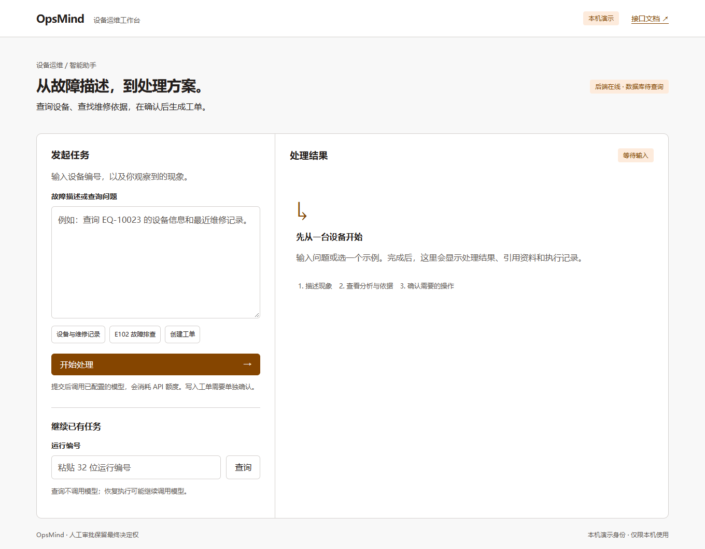
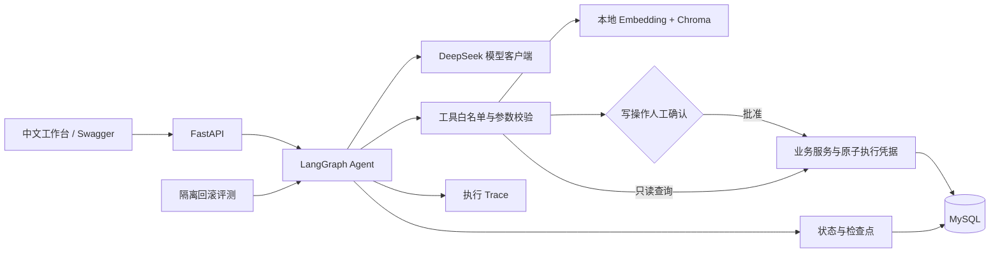

# OpsMind

企业设备智能运维工单 Agent 学习与求职项目，按阶段构建。

**初学者从这里开始：[项目全景指南](docs/项目全景指南.md)**，包含完整流程、技术分工、目录、审批、知识库、测试和代码阅读路线。当前采用本地学习方式，Docker/WSL 暂不安装。

**当前阶段：P7 部署与展示。** 中文工作台、Docker 配置和展示文档已实现。219 项自动测试通过；Docker 实跑与真实模型最终联调待完成。

最终目标：结合业务数据和知识库诊断设备故障，经人工确认后创建或修改工单。已实现业务查询、RAG、审批、持久恢复与评测。

## 演示工作台



启动后打开 [工作台](http://127.0.0.1:8000/)，输入故障描述、查看依据并确认工单操作。示例按钮只填入文字，提交才调用模型。
详见 [P7 启动教程](docs/p7-guide.md)、[阶段报告](docs/p7-report.md) 与 [GitHub / 面试展示](docs/showcase.md)。

## 架构



本机演示系统，无正式登录；审批由服务端验证动作，不依赖前端按钮控制。

## 快速开始（Windows / PowerShell）

需要 Python 3.13、uv、Git、已启动的 MySQL 8（CHECK 约束要求 8.0.16+）。所有命令在项目根目录运行；PyCharm 选择已有解释器 `.venv/Scripts/python.exe`。

```powershell
uv sync --locked --cache-dir .uv-cache
# 仅首次配置：本机交互输入管理员密码，创建独立库与专用账号。
.\.venv\Scripts\python.exe scripts/setup_local_mysql.py
.\.venv\Scripts\alembic.exe upgrade head
.\.venv\Scripts\python.exe scripts/seed_demo.py
.\.venv\Scripts\python.exe -m uvicorn opsmind.main:create_app --factory --host 127.0.0.1 --port 8000
```

已配置数据库的机器跳过 setup_local_mysql.py。它不覆盖已有连接配置；若指定库已有表，会停止保护现有数据。脚本只保存生成的应用账号连接串，不保存管理员密码。手动配置可参考 `.env.example`，不要覆盖已有 `.env`。

浏览器打开 [工作台](http://127.0.0.1:8000/) 或 [接口文档](http://127.0.0.1:8000/docs)，查询 `EQ-10023`。完整的新手步骤见 [P1 操作教程](docs/p1-guide.md)。

## P6 评测与执行 Trace

运行 `.\.venv\Scripts\python.exe scripts/evaluate.py` 生成本地评测报告，默认不调用付费模型。
查看 [P6 新手教程](docs/p6-guide.md) 和 [P6 阶段报告](docs/p6-report.md)。新增 GET `/api/v1/agent/runs/{run_id}/trace` 查看运行指标与事件。

## P5 持久 Agent 流程

Agent 改为 LangGraph 节点流程，审批可跨进程恢复。新增 `POST /api/v1/agent/runs/{run_id}/resume`，恢复不等于批准。
查看 [P5 学习与操作教程](docs/p5-guide.md)、[P5 阶段报告](docs/p5-report.md) 和 [ADR 0006](docs/adr/0006-langgraph-mysql.md)。
升级到迁移 0004 后重启后端。强制退出遗留的运行锁最长 420 秒后可接管；业务写入仍依据原子执行凭据防重。

## P4 知识库

新增 Markdown/TXT 导入、本地 Embedding、Chroma 检索及 `search_knowledge` 工具。
先按 [P4 新手教程](docs/p4-guide.md) 重启服务并尝试 `/api/v1/knowledge/search`。
实施结果和局限见 [P4 阶段报告](docs/p4-report.md)，选型见 [ADR 0005](docs/adr/0005-local-rag.md)。

## P3 Agent

新增运行、结果查询和确认接口；只读工具自动执行，写入等待具体动作确认。升级数据库后重启服务，详见 [P3 操作说明](docs/p3-guide.md) 和 [P3 阶段报告](docs/p3-report.md)。

## P2 模型分析

新增 POST /api/v1/analyses，只分析用户输入，不查询数据库或写入工单。用户选择 DeepSeek deepseek-v4-pro；密钥存本机 .env。配置、真实调用验证和错误说明见 [P2 操作教程](docs/p2-guide.md)。

## 已实现接口

| 方法与路径 | 功能 |
| --- | --- |
| POST /api/v1/agent/runs | 创建并推进 Agent 运行 |
| GET /api/v1/agent/runs/{run_id}/trace | 查询执行记录与指标 |
| GET /api/v1/agent/runs/{run_id} | 查询运行状态与执行凭据 |
| POST /api/v1/agent/runs/{run_id}/resume | 从检查点恢复，不自动批准 |
| POST /api/v1/agent/runs/{run_id}/decisions | 确认或拒绝具体写操作 |
| POST /api/v1/knowledge/search | 检索知识片段及来源 |
| POST /api/v1/analyses | 模型初步分析（不写工单） |
| GET /health | 进程健康检查，不代表数据库连接正常 |
| GET /api/v1/equipment/{equipment_no} | 设备基本信息 |
| GET /api/v1/equipment/{equipment_no}/maintenance-records | 维修历史 |
| GET /api/v1/equipment/{equipment_no}/tickets | 工单历史 |
| POST /api/v1/tickets | 创建工单 |
| PATCH /api/v1/tickets/{ticket_no} | 更新允许的字段 |

历史接口使用 limit（默认 20，最大 100）和 offset（默认 0，最大 10000），按时间、ID 倒序排序，返回 items、limit、offset。不存在的设备返回 404；参数错误返回 422；业务状态冲突返回 409；操作员工无权限返回 403；数据库不可用返回 503。错误响应不回传 SQL 或请求原文。

P1 使用服务端配置的演示员工 `OPSMIND_DEMO_EMPLOYEE_NO`，默认 `EMP-1001`。请求不能指定 created_by。**这不是认证系统，只适合本机演示，不应暴露到公共网络。** production 配置会拒绝启动。P3 Agent 写入必须通过确认接口；P1 的手动工单接口仍是独立的用户主动操作入口。

## 验证

```powershell
.\.venv\Scripts\ruff.exe check .
.\.venv\Scripts\ruff.exe format --check .
# 普通测试；真实数据库测试会明确跳过
.\.venv\Scripts\python.exe -m pytest -q
# 完整验收：必须有有效的独立 MySQL 测试库
.\.venv\Scripts\python.exe -m pytest --mysql -q
.\.venv\Scripts\alembic.exe check
```

完整测试在本机已通过 219 项，其中 P2 新增 61 项、P3 新增 37 项、P4 新增 26 项、P5 新增 11 项、P6 新增 29 项、P7 新增 3 项、RAG 联调修复新增 8 项。完整验收使用 `pytest --mysql --embedding -q`，需先准备本地模型。模型 HTTP 使用模拟传输；真实模型检查单独运行，不计入自动测试。测试限定本机 `opsmind_test`，拒绝与应用/迁移库同名；每个测试使用外层事务隔离，结束后回滚。不使用 SQLite 或 Mock 替代 MySQL 的业务与约束测试。错误响应单元测试注入数据库异常，仅验证响应脱敏。

当前完整测试保留 AnyIO 弃用提示和 FastEmbed mean pooling 说明。P5 的传递依赖引入 httpx2 后，原 TestClient 的 httpx 提示已不再出现。

## 目录与依赖

```text
src/opsmind/
  main.py          服务入口
  core/            配置、日志、枚举和业务异常
  api/             路由、请求依赖、错误响应
  schemas/         输入校验与输出结构
  services/        查询与工单规则、写事务
  db/              ORM、连接、示例数据
  tools/           工具白名单与执行
  agent/           LangGraph、持久化与确认
  web/             中文演示工作台
  evaluation/      隔离评测与报告
  observability/   安全 Trace 与指标
  rag/             文档切分、向量检索与引用
knowledge/         虚构演示资料
alembic/           可版本化的数据库迁移
scripts/           本机数据库配置与数据导入
tests/             单元与真实数据库集成测试
docs/              架构、决策和学习说明
```

| 依赖 | 用途 |
| --- | --- |
| pydantic-settings / Pydantic | 配置、请求和响应校验 |
| FastAPI | HTTP 接口和 OpenAPI 文档 |
| Uvicorn | ASGI 服务运行 |
| SQLAlchemy | ORM 与事务 |
| PyMySQL[rsa] | MySQL 驱动及认证所需的 RSA 支持 |
| Alembic | 表结构迁移 |
| httpx | 模型 HTTP 调用与 HTTP 测试传输 |
| pytest | 自动化测试 |
| Ruff | 代码检查与格式化 |
| Hatchling | src 布局包的构建与安装 |

配置顺序：显式构造参数 > 环境变量 > 根目录 .env > 默认值。日志输出 UTC 时间、级别、模块和事件；禁止记录密码、配置全文和原始业务请求。SecretStr 只是防止意外打印，不是加密或自动日志脱敏。

## 阶段规划

P0 工程基础 → P1 业务后端 → P2 模型客户端 → P3 手写 Agent 与工具审批 → P4 RAG → P5 LangGraph → P6 评估与观测 → **P7 部署展示**。

每阶段验收后暂停。详见 [项目要求](项目.md)、[架构](docs/architecture.md)、[数据库](docs/database.md)、[P1 报告](docs/p1-report.md)、[学习与作品证据](docs/learning.md)、[P2 报告](docs/p2-report.md)。

P4 新增直接依赖：chromadb（本地向量索引）和 fastembed（本地多语言 ONNX 推理）。完整测试还会显示模型 mean pooling 行为说明，见 P4 教程。

P5 新增直接依赖 langgraph（节点、条件分支、持久中断恢复），其传递依赖与版本由 uv.lock 固定。现有 LLM HTTP 客户端继续复用。

真实 RAG 联调发现的检索与引用边界修复见 [2026-10-12 修复记录](docs/rag-acceptance-fix.md)。
