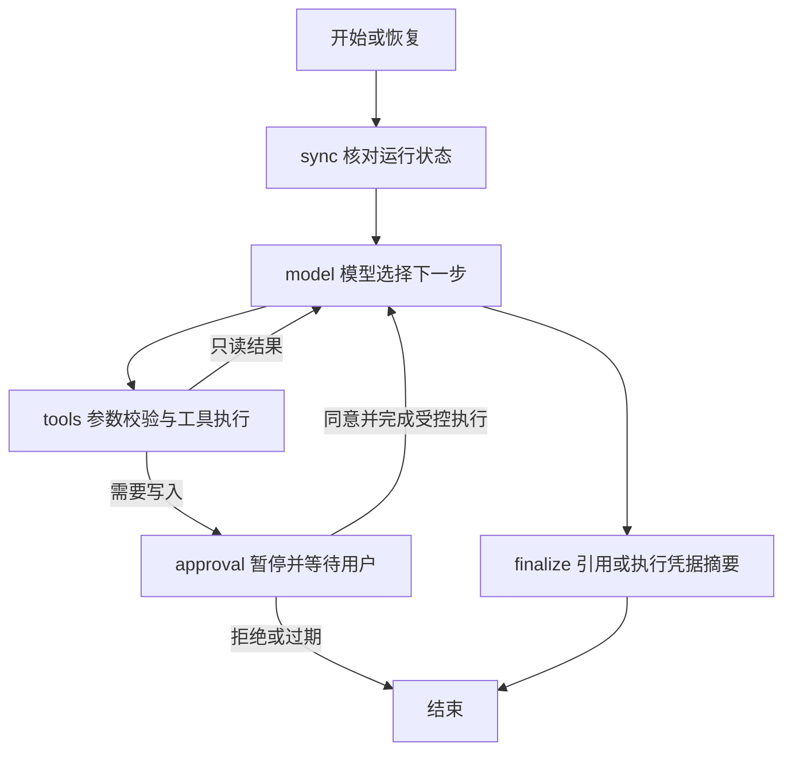

# P5：LangGraph 学习与操作教程

## 这次学什么

P3/P4 用一个手写 while 循环反复调用模型与工具。P5 用 LangGraph 表达相同的业务过程，重点是状态、分支、暂停、保存进度和恢复。

| 概念 | 本项目里的含义 |
| --- | --- |
| State | GraphState：运行编号、员工编号、当前结果、模型输出、动作、处理耗时与执行标识 |
| Node | sync 核对状态，model 请求模型，tools 执行或提议工具，approval 等待确认，finalize 整理回答 |
| Edge | 节点之间的执行路径，例如开始先进入 sync |
| Conditional Edge | 根据状态进入下一个节点，具体业务工具仍由模型选择 |
| Checkpoint | 保存在 MySQL 的图进度与节点结果，不依赖进程内存 |
| interrupt | 停在审批节点，把具体动作返回给用户 |
| Command(resume=...) | 将经接口校验的确认结果交给暂停的图 |



为了避免出现两份互相矛盾的业务数据，完整消息、预算、权限与执行凭据仍以 agent_run 为准。GraphState 保存推进节点所需的数据，恢复时重新核对数据库。

## 为什么不能只保存一个“已批准”布尔值

确认必须绑定具体 action_id 和服务器保存的参数。模型的文字“用户已同意”不是授权。一个动作的批准不能被拿去执行另一个动作。

LangGraph 恢复时可能重新执行节点。假如工单已经写入，但检查点还没保存就断电，不能再创建一次。因此：

1. 工单写入和执行凭据仍在同一个 MySQL 事务提交。
2. 审批节点重放时先找对应凭据，已有结果就继续流程，不重做写入。
3. 只读工具结果和待确认动作使用 effect_id 识别已应用节点，防止重复计数或生成新动作。
4. 同一运行有数据库运行锁，同时恢复时其中一个请求可能收到 409 run_busy。
5. 锁拥有者发生变化后，旧执行者的状态写入和检查点保存都会被拒绝。

这不代表所有外部操作都有 exactly-once 保证。模型请求在响应尚未保存时遇到进程退出，恢复可能重新调用模型；步骤预算不会重置。

## 已完成的本机准备

依赖已锁定，开发库与测试库已升级到 Alembic 0004。新增 graph_checkpoint 表及 agent_run 的运行锁字段；原有设备、工单、知识库记录未删除。

新增直接依赖 langgraph；langchain-core、langgraph-checkpoint 等由它传递引入。仍使用原有 DeepSeek HTTP Client，未改成 LangChain 模型封装。

本轮没有进行付费模型调用。按你的安排，Swagger 手动体验与真实模型联调留到最后统一做。

## 以后统一自测时如何操作

先启动 MySQL，在 PyCharm 的 Terminal 中执行：

```powershell
uv sync --locked --cache-dir .uv-cache
.\.venv\Scripts\alembic.exe upgrade head
.\.venv\Scripts\python.exe -m uvicorn opsmind.main:create_app --factory --host 127.0.0.1 --port 8000
```

打开 http://127.0.0.1:8000/docs。原来的创建、查询、确认运行接口继续可用。

### 查询类任务

`POST /api/v1/agent/runs`：

```json
{"message":"仅查询 EQ-10023 的设备和维修记录，结合 DEMO-24V E102 资料给出可能原因，引用来源。每轮一个工具，不创建工单。"}
```

应观察到 completed 或明确的错误原因，知识库引用规则沿用 P4。

### 人工确认与重启恢复

创建一个明确标注为测试的工单提议，记录返回的 run.id 和 pending_action.action_id。看到 waiting_confirmation 时尚未写入。

停止并重启服务，再 GET `/api/v1/agent/runs/{run_id}` 查看原动作。向 `/decisions` 提交：

```json
{"action_id":"填写本次返回的动作编号","approved":true}
```

应只执行一次。重复相同确认不会再次创建；改成相反决定会冲突。填写错误动作编号不会写入。批准会真实创建开发库工单，测试时自行核对标题和参数。

### 恢复中断的运行

新增 `POST /api/v1/agent/runs/{run_id}/resume`，不需要请求体。

- 它只继续保存的进度，不是“批准”按钮。待审批任务仍等待确认。
- 已完成、已拒绝、已失败的任务返回现有状态，不重新执行。
- 如果上次写入已提交而图尚未保存完成，恢复依据执行凭据继续，不重复写入。
- 进程被强制终止可能留下最长 420 秒的运行锁。期间返回 run_busy，等锁到期再恢复。正常结束或捕获到异常会释放锁。
- 等待审批仍有绝对有效期。P5 执行中的任务可在停机后恢复，处理预算仍沿用剩余额度，不把停机时间算成推理时间。

恢复不是后台自动执行；需要调用恢复接口或重新提交同一已授权确认。当前没有守护进程扫描任务。

## 自动验收

```powershell
.\.venv\Scripts\ruff.exe check .
.\.venv\Scripts\ruff.exe format --check .
.\.venv\Scripts\python.exe -X utf8 -m pytest --mysql --embedding -q
.\.venv\Scripts\alembic.exe check
```

本轮 179 项通过，其中 P5 新增 11 项；包括真正启动另一个 Python 进程从 MySQL 恢复审批，以及使用独立连接并发确认。聊天模型使用受控响应，不消耗 API 额度；数据库和检查点使用真实 MySQL。

仍有两条依赖提示：AnyIO 弃用提示和 FastEmbed mean pooling 说明。LangGraph 的传递依赖安装了 httpx2，之前 TestClient 的 httpx 提示不再出现。

## 建议阅读代码的顺序

先看 graph_state.py，再看 graph.py 理解节点连接；然后阅读 nodes.py 中 model、apply 和 approval。最后看 runtime.py、checkpointer.py、store.py 与 approval.py，理解接口、保存进度和事务之间的关系。

检查点是服务端内部数据，HTTP 不接受任意 checkpoint_id，也不开放时间旅行、改写状态或历史删除接口。检查点可能包含业务文本，应像业务数据库一样保护。

## 本阶段边界

适合本机单图顺序流程；没有多 Agent、并行工具分支或子图。检查点存储按当前版本实现并测试，不是通用 MySQL 插件。检查点完整快照会增长，尚无清理保留策略。跨不兼容图版本的运行迁移需要单独设计。

RAG 的引用校验与诊断准确性局限仍存在。P5 改善的是执行流程与恢复，不会自动提高模型的事实判断能力。
