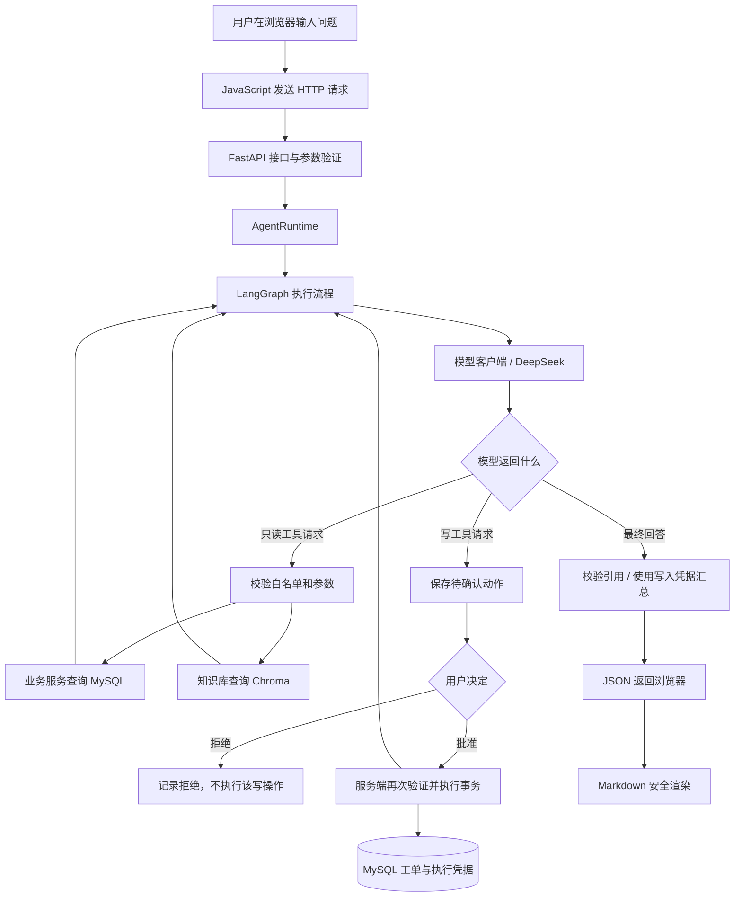

# OpsMind 项目全景指南

> 面向第一次接触后端、数据库和 Agent 的读者。根据当前代码整理，更新于 2026-10-12。
> 当前目标：本地学习、积累工程经验和现场演示。用 PyCharm + MySQL + 浏览器即可；Docker/WSL 不是学习前提，容器配置保留为可选材料，未完成实际运行验收。

## 怎样阅读

第一遍读第 1～5 节，理解一次操作怎样完成；第二遍读第 6～10 节，理解技术细节；遇到问题时查第 11～15 节。不要试图一次背下所有类名。

- [1. 项目解决什么问题](#1-项目解决什么问题)
- [2. 技术栈分别负责什么](#2-技术栈分别负责什么)
- [3. 从整体看程序](#3-从整体看程序)
- [4. 一次查询的完整过程](#4-一次查询的完整过程)
- [5. 一次创建工单的完整过程](#5-一次创建工单的完整过程)
- [6. Agent 怎样决定下一步](#6-agent-怎样决定下一步)
- [7. 数据库保存什么](#7-数据库保存什么)
- [8. RAG 知识库怎样工作](#8-rag-知识库怎样工作)
- [9. LangGraph状态与恢复](#9-langgraph状态与恢复)
- [10. 页面怎样显示结果](#10-页面怎样显示结果)
- [11. 测试评测与执行记录](#11-测试评测与执行记录)
- [12. 目录与代码阅读顺序](#12-目录与代码阅读顺序)
- [13. 本机启动配置与排错](#13-本机启动配置与排错)
- [14. 已完成的阶段与当前边界](#14-已完成的阶段与当前边界)
- [15. 学习路线自测与文档索引](#15-学习路线自测与文档索引)

## 1. 项目解决什么问题

假设一台设备报警，维护人员通常需要：查设备型号、查历史维修、翻说明书、提出处理建议，再创建或更新工单。

OpsMind 把这些步骤连接起来：用户用自然语言描述需求，模型选择合适的工具，程序查询数据库或知识库；涉及工单写入时，先展示操作内容，经用户确认后再执行。

例如：“EQ-10023 出现 E102 报警，帮我看看怎么处理。”系统可以先查型号，再查对应资料，给出附带引用的建议。模型不直接连接 MySQL 执行任意 SQL，也不能仅凭自己的一句话批准工单。

三个基础概念：

| 概念 | 本项目中的含义 |
| --- | --- |
| 设备 | 被管理的对象，例如 EQ-10023 |
| 维修记录 | 某次已经记录下来的维修情况：时间、现象、处理措施、结果 |
| 工单 | 一项待处理或已处理的任务，有负责人、优先级和状态 |

“新建工单”不等于“完成维修”。一台设备可以有多条维修记录和多张工单；目前没有把某条维修记录直接关联到某张工单的字段，不能擅自认定两条记录属于同一次维修。

## 2. 技术栈分别负责什么

| 技术或工具 | 通俗理解 | 本项目用途 |
| --- | --- | --- |
| Python | 编写后端程序的语言 | 业务、Agent、数据处理 |
| PyCharm | 写代码和启动程序的工具 | 使用项目虚拟环境运行后端 |
| HTML / CSS / JavaScript | 页面结构、样式、交互 | 中文工作台 |
| HTTP / JSON | 通信方式 / 数据表示格式 | 浏览器和后端交换请求与结果 |
| Uvicorn | 接收网络请求的服务程序 | 监听本机 8000 端口并运行 FastAPI 应用 |
| FastAPI | 组织接口的框架 | 路由、参数验证、响应、Swagger |
| Pydantic | 检查数据结构和类型 | 输入参数、模型输出、配置检查 |
| SQLAlchemy | 用 Python 操作数据库的工具 | ORM 对象、查询、事务和连接 |
| MySQL | 保存结构化数据的数据库 | 设备、工单、运行记录、检查点 |
| Alembic | 数据库结构的版本管理工具 | 按迁移文件创建和升级表 |
| httpx | Python HTTP 客户端 | 后端请求 DeepSeek |
| DeepSeek | 通过网络调用的语言模型 | 理解自然语言、选择工具、整理回答 |
| LangGraph | 组织有状态执行流程的框架 | 模型、工具、审批节点与恢复 |
| FastEmbed | 本地文本向量计算工具 | 使用多语言 MiniLM 把文字变成向量 |
| Chroma | 本地向量存储与检索工具 | 保存资料片段和向量，查找相近内容 |
| pytest / Ruff | 自动测试 / 代码检查 | 验证行为、检查格式和常见问题 |
| uv / uv.lock / .venv | 依赖管理 / 版本记录 / 隔离环境 | 准备并固定项目 Python 环境 |
| Marked / DOMPurify | Markdown 解析 / HTML 安全过滤 | 安全显示标题、列表、表格和代码 |
| Git | 代码版本管理 | 保存修改历史、比较与回退代码 |

本项目没有训练大模型，也没有把知识文档训练进 DeepSeek。当前聊天模型通过外部 API 调用，业务库、Embedding 与向量索引在本机。因此“本地运行项目”不等于“完全离线运行”。

## 3. 从整体看程序



图中的查询顺序不是固定脚本：模型可能先查设备，也可能先查维修历史。程序限定可选工具、参数、权限和预算。知识库查询还会从 MySQL 读取可用文档元数据，图中为便于理解省略这条连接。

项目有三条不同入口，不要混为一谈：

| 路径 | 特点 |
| --- | --- |
| P1 业务 API | 直接查询设备或人工提交工单参数，不经过模型 |
| P2 `/api/v1/analyses` | 对输入描述做结构化模型分析，不查询业务数据库 |
| 当前工作台 Agent API | 模型可多步选择工具，Agent 写操作必须经过审批 |

**Agent 审批规则保护的是 Agent 写工具。P1 的手动工单接口是另一个主动操作入口，并不是全部业务写入都要经过 Agent。**

## 4. 一次查询的完整过程

以“帮我瞅瞅 EQ-10023 以前都修过啥”为例。

### 4.1 页面读取输入

[web/app.js](../src/opsmind/web/app.js) 监听表单提交，将文字放入 `message`，发送：

```http
POST /api/v1/agent/runs
Content-Type: application/json
```

```json
{"message": "帮我瞅瞅 EQ-10023 以前都修过啥"}
```

HTTP 是通信规则；JSON 是这里传递数据的格式。即使浏览器和 Python 都在同一台电脑，它们仍通过请求和响应交流。

### 4.2 接口接收与检查

[api/agent.py](../src/opsmind/api/agent.py) 中的 `create_run()` 接收请求。[schemas/agent.py](../src/opsmind/schemas/agent.py) 中 `RunCreate` 要求 `message` 是去掉首尾空白后长度为 1～4000 的字符串，并拒绝额外字段。

接口的主要一行是：

```python
return await runtime.create(data.message, actor)
```

- `data.message`：已经按输入模型检查的任务文字。
- `actor`：服务端配置的演示员工编号，默认 EMP-1001，不是模型指定的身份。
- `runtime`：组织 Agent 执行的对象。
- `await`：等待异步操作完成，不能理解成“自动开启一个线程”。数据库等阻塞操作在具体实现中另有 offload 处理。

### 4.3 建立运行记录

[agent/runtime.py](../src/opsmind/agent/runtime.py) 的 `create()` 先调用 `store.create()`，生成运行编号并保存任务状态，然后进入执行流程。

**此时可能已经新增 `agent_run` 记录，但没有因此新增 `ticket` 工单。**

这正是“提交任务”和“写入工单”的区别。运行编号是追踪一次 Agent 任务的编号；工单编号是业务任务的编号。

### 4.4 模型请求一个工具

后端给模型发送任务、系统提示以及允许使用的工具定义。模型可能返回下面这样的工具请求（简化示例）：

```json
{
  "name": "get_maintenance_history",
  "arguments": {"equipment_no": "EQ-10023"}
}
```

这只是模型提出的请求，还不是数据库查询结果。程序验证工具名和参数，再通过业务服务查询 MySQL。

### 4.5 查询结果返回模型，再返回用户

工具返回真实记录，例如“更换电池并检查接线，维修后测试正常”。结果加入这次运行的消息，模型继续决定：需要查询更多信息，还是给出最终回答。

因此两个工具调用通常需要多次模型往返。工具结果回传后，模型还需要一次调用组织最终答案。协议纠正也可能增加调用次数。

接口最终返回 `RunRead` JSON，包含运行状态、回答、待确认动作等；页面显示内容，并单独请求 Trace。

当前不是逐字流式输出。创建任务的 HTTP 请求通常等待本轮执行完成、失败或进入审批等待后才返回。首次请求在拿到编号前断连时，页面无法自动找回该任务，不应盲目重复提交。

## 5. 一次创建工单的完整过程

### 5.1 模型提出，程序保存

用户输入“给 EQ-10023 开个维修单”。模型可能先查询相关信息，然后请求 `create_ticket`。

程序校验参数后，保存 `pending_action`，内容包含工具名、参数、`action_id` 和有效期，状态变为 `waiting_confirmation`。页面显示这些内容，但工单还未因该提议写入。

### 5.2 用户决定

确认或拒绝通过另一条接口提交：

```http
POST /api/v1/agent/runs/{run_id}/decisions
```

```json
{"action_id": "这里是本次待确认动作的32位编号", "approved": true}
```

上面的编号是说明用占位文本，实际请求必须填写程序生成的合法编号。点击拒绝时 `approved` 为 `false`。

### 5.3 服务端执行审批规则

[agent/approval.py](../src/opsmind/agent/approval.py) 检查运行归属、有效期、当前状态、动作编号和已有决定。批准后重新检查工具参数，并通过业务层核对设备、员工角色、处理人和工单状态规则。

“批准”是必要条件，不保证业务写入一定成功。例如设备不存在、处理人无效，仍然应失败。

成功写入时，工单变更与执行凭据在同一数据库事务中提交；业务操作失败时，使用保存点回滚业务变更，并记录失败结果。

- **事务**：让一组数据库变更作为整体提交或回滚。
- **行锁**：避免两个请求同时修改同一运行，彼此看不到对方的决定。
- **执行凭据**：保存本次动作实际执行结果，不能把模型的“已成功”当成凭据。
- **幂等**：同一个动作重复提交同样决定时，复用已有记录，不再执行一次业务写入。

不同的新运行仍可能提出相似工单；“同一动作防重复”不等于“自动识别所有语义重复工单”。

### 5.4 返回结果

拒绝：保存拒绝记录，状态变为 `rejected`，不执行该动作的工单写入。

批准：尝试执行业务写入，将结果反馈给图流程。实际批准写入的最终摘要使用数据库执行凭据，避免模型虚构成功。

我们已在本机真实验证过拒绝和确认创建，并只读核对了创建后的工单。

## 6. Agent 怎样决定下一步

这里的 Agent 可以理解为“模型 + 工具 + 状态 + 执行约束”。只让模型回答一句话是普通模型调用；允许它根据中间结果选择下一步工具，才形成这里的 Agent 流程。

### 工具白名单

定义在 [tools/registry.py](../src/opsmind/tools/registry.py)。

| 工具 | 作用 | 执行方式 |
| --- | --- | --- |
| `get_equipment` | 查询设备信息 | 校验后只读执行 |
| `get_maintenance_history` | 查询维修记录 | 校验后只读执行 |
| `get_ticket_history` | 查询工单历史 | 校验后只读执行 |
| `search_knowledge` | 检索知识资料 | 校验后只读检索 |
| `create_ticket` | 提出创建工单 | 等待审批 |
| `update_ticket` | 提出修改工单 | 等待审批 |

工具定义包含用途、参数 Schema 和风险级别。Schema 是参数格式说明，例如必须传设备编号、哪些字段允许为空。实际执行位于 `tools/executor.py` 与 RAG 流程；数据库规则在 `services/`，不是写在 Prompt 中。

没有任意 SQL、Shell 或删除工具。模型知道一个函数名，并不意味着它就能执行任意 Python。

### Prompt 与程序规则

[agent/prompts.py](../src/opsmind/agent/prompts.py) 的系统提示指导模型：使用中文、不编造来源、每轮一个工具、信息不足时说明局限等。

Prompt 是行为指引，不是可靠的权限边界。真正的白名单、参数验证和写入审批由程序执行。不能只写一句“不要乱操作”就认为安全。

默认最大 6 个模型步骤、8 次工具调用、120 秒处理预算、1800 秒审批有效期；配置可以覆盖默认值。不是某个限制存在，就保证每次任务都能用满其他限制。

出现 `llm_multiple_tool_calls` 表示模型一次提出多个工具调用。当前程序拒绝这一轮多工具请求，提示模型改为每轮一个；纠正仍会消耗步骤和模型额度。

### 口语与记忆

口语任务“以前修过啥”已在一次真实试验中被理解，但回答曾错误合并不同记录。提示已加强，尚未真实复测改进效果；不能由一次成功推导所有口语都可靠。

同一次运行会保留消息和工具结果。**每次点击“开始处理”是新的独立运行，不自动继承上一任务。** “那给它开个单”可能缺少设备信息，应重新写明设备编号。持久状态不等于已经实现跨任务长期记忆。

## 7. 数据库保存什么

### MySQL 表

| 表 | 内容 |
| --- | --- |
| `equipment` | 设备编号、型号、位置、状态等 |
| `employee` | 员工编号、角色、是否有效；不是登录账户系统 |
| `maintenance_record` | 设备维修时间、措施、结果、维修人员 |
| `ticket` | 工单编号、描述、优先级、状态、创建人、处理人 |
| `agent_run` | 一次运行的消息、事件、预算、待审批动作和结果 |
| `knowledge_document` | 文档来源、版本、摘要哈希、索引版本、就绪状态和片段数 |
| `graph_checkpoint` | LangGraph 恢复所需的检查点与部分执行结果 |

设备与维修记录、工单都是一对多关系；维修记录和工单通过外键关联设备、员工。外键可以阻止引用不存在的关联对象。删除采用 RESTRICT 保护历史，本项目不提供删除接口，设备可通过状态停用。

当前业务与 Agent 各表的主键类型不同：业务实体多为自增整数，运行和知识文档等使用字符串标识；不要把早期数据库设计的约定套到所有新增表。

### 工单状态

```text
open（待处理） → in_progress（处理中） → resolved（已解决） → closed（已关闭）
                       ↑                     │
                       └─────────────────────┘
open / in_progress → cancelled（已取消）
```

已解决可以回到处理中；已关闭或已取消后禁止编辑。处理中及之后要求处理人，已解决及已关闭要求填写诊断。规则定义在 `core/domain.py`、输入模型和业务服务中。

### 三个容易混淆的对象

- ORM 模型：例如 `db/models.py` 的 `Ticket`，描述数据库表与 Python 对象的映射。
- 输入/输出模型：例如 `TicketCreate`、`EquipmentRead`，描述 API 接收或返回的数据形状，不等于表。
- 迁移文件：`alembic/versions/` 记录怎样修改数据库结构。改了 ORM 类不会自动把已有数据库表改好。

Session 可以先理解为“一次与数据库打交道的工作上下文”，不是浏览器聊天会话。

## 8. RAG 知识库怎样工作

RAG 是“先检索资料，再让模型结合资料回答”。它不修改模型参数，不等于微调，也不保证模型一定正确使用证据。

### 导入阶段

```text
Markdown/TXT 文件 → 切成片段 → 本地计算向量 → 写入 Chroma
                  ↘ MySQL 保存文档元数据和状态 ↗
```

源文件在 `knowledge/`；当前演示资料的型号、报警码和规则均为虚构，不能用作真实设备维修依据。

[rag/service.py](../src/opsmind/rag/service.py) 管理导入。相同来源和版本不能偷偷换内容；内容变了应使用新版本。索引写入不是 MySQL 事务的一部分，所以先标记 indexing，写入完成后才标记 ready。查询只使用 ready 的兼容索引文档，避免展示半完成的导入结果。

### 查询阶段

1. 从 MySQL 找到符合条件的 ready 文档。
2. 用本地 Embedding 把问题转换为向量。
3. 在 Chroma 中检索候选片段。
4. 按距离阈值过滤；候选标题明确匹配查询的完整型号和报警码时，有补充匹配规则。
5. 将片段文字、来源、版本、行号和引用编号返回模型。
6. 模型组织回答，程序检查引用编号是否来自真实工具结果。

向量是表示文本的一组数字，距离用于衡量相近程度，不是“答案正确率”。当前补充规则针对向量候选集中的型号与 E 系列报警码精确匹配，不能当成通用搜索系统。

### 两种存储的分工

MySQL 保存结构化业务和文档元数据；Chroma 保存资料片段、向量及关联信息。只保留一个，不能认为完整知识库仍然可用。

### 引用校验的边界

`[KB-...]` 中的真实编号对应资料片段。程序可以发现未知编号、找到资料却没有引用等情况；但编号合法不等于该段话确实支持模型的结论。字面占位符 `[KB-...]` 本身不会再被误当作真实引用。

此前真实查询曾因阈值过严而为空，又因回答提及占位符被误拦截；已修复并补测试。细节见 [RAG 联调修复](rag-acceptance-fix.md)。

## 9. LangGraph状态与恢复

[agent/graph.py](../src/opsmind/agent/graph.py) 将执行拆成节点：

| 节点 | 职责 |
| --- | --- |
| sync | 读取当前权威运行状态 |
| model | 调用模型，获得工具请求或回答 |
| tools | 应用工具请求，只读执行或保存审批提议 |
| approval | 持久中断，等待用户决定，再应用审批 |
| finalize | 应用最终回答并结束 |

“图”是节点和条件连接，不是页面图表，也不是多个智能体。当前工具和 finalize 共用部分实现，通过模型返回内容区分行为。

检查点帮助记住执行位置；`agent_run` 保存业务上的权威状态、消息和凭据。进程中断后可尝试恢复，但不能因此跳过审批。

节点可能重放，程序用 `effect_id` 和审批凭据避免重复应用业务效果；运行租约和执行者令牌避免并发推进互相覆盖。强制退出后，旧租约可能要等到过期才能接管，当前租约为 420 秒；不要看到未立刻恢复就连续提交新任务。

`POST /api/v1/agent/runs/{run_id}/resume` 是恢复运行，不是批准动作。这与点击“确认执行”不同。

## 10. 页面怎样显示结果

页面由 FastAPI 在 `/` 提供，静态资源位于 `/assets`。前后端同源，不需要单独启动一个前端开发服务器。

```text
RunRead JSON → app.js 更新状态与按钮
回答文字 → Marked 解析 Markdown → DOMPurify 白名单过滤 → 插入回答区域
Trace JSON → 显示来源、调用与用量
```

只有回答区域进行 Markdown 渲染；审批参数等仍按纯文本显示。允许常规排版，不允许脚本、外部图片、表单、危险链接等；库加载或解析失败回退纯文本。过滤库需要维护更新，不能因为装过一次就认为永远没有风险。

原始回答保存在服务端，前端排版改变不需要重新调用模型。刷新页面后按已有运行编号“查询”，即可重新显示历史结果。

三个按钮的区别：

| 操作 | 是否可能调用模型 |
| --- | --- |
| 查询 / 刷新已有状态 | 不调用 |
| 开始处理 | 创建新运行，调用模型 |
| 恢复执行 / 确认后继续 | 可能继续调用 |

## 11. 测试评测与执行记录

### 自动测试

pytest 测试配置校验、数据库约束、业务 API、模型协议、审批防重、图恢复、检索和评分器等。数据库集成测试使用真正的本机 `opsmind_test`，不是用 SQLite 代替 MySQL。

通常用外层事务隔离测试，结束回滚。特殊持久恢复测试另有专门安排，仍限定测试环境。模型 HTTP 多采用受控响应，避免随机性和费用。

截至本次文档整理，最近完整测试结果为 **219 项通过**，这是之前的回归结果，不是本次写文档重新运行的结果。Markdown 另有浏览器安全与布局检查。

### Evaluation 评测

`evaluation/cases.v1.jsonl` 保存 18 个案例，脚本检查工具参数、任务状态、引用、答案条件和数据库变化。

- scripted：使用预设模型响应，验证程序与评分流程；知识检索仍可用真实本地模型。
- live：调用真实模型，会产生费用。预设模拟超时案例被排除，因此完整 live 集合为 17 题。

评测在独立本机测试库中执行，事务回滚，JSON/Markdown 报告保存在 `.data/evaluation-reports/`。之前 18/18 脚本通过不表示真实模型准确率 100%。关键词匹配也不能完整判断诊断语义是否正确。

### Trace 执行记录

Trace 是一次运行的过程记录：模型调用、工具执行、检索来源、审批、耗时、错误等。它与普通终端日志、LangGraph 检查点不是同一个东西。

| 指标 | 怎样理解 |
| --- | --- |
| 模型调用 | 与模型交互了几轮，包含可能的协议纠正 |
| 工具调用 | 已记录的工具执行/提议次数，不等于工单写入次数 |
| Token | 模型计量文本的单位，不等于字数；缺失用量显示未知 |
| 已记录处理耗时 | 已观测模型、工具与写入耗时，不是完整墙钟时间 |
| 审批等待 | 已结束审批等待时间，不是当前待确认倒计时 |

`completed` 只说明执行结束，不代表诊断一定正确。引用被拦截后的提示也可能作为终止结果显示“已完成”。批准成功要看执行凭据，必要时核对实际数据库。

## 12. 目录与代码阅读顺序

```text
OpsMind/
├─ src/opsmind/
│  ├─ main.py          应用创建、路由、首页
│  ├─ web/             页面结构、样式、交互、Markdown 过滤
│  ├─ api/             HTTP 入口与依赖
│  ├─ schemas/         输入输出模型
│  ├─ services/        业务规则
│  ├─ db/              ORM、连接和种子数据
│  ├─ llm/             模型 HTTP 客户端、协议和用量解析
│  ├─ tools/           工具定义、参数校验、执行适配
│  ├─ agent/           图、运行、审批、状态和检查点
│  ├─ rag/             导入、切分、Embedding、检索和引用
│  ├─ evaluation/      评测加载、执行、评分和报告
│  ├─ observability/   安全 Trace 投影与指标
│  └─ core/            配置、业务枚举、异常和日志
├─ alembic/            数据库迁移
├─ scripts/            启动、配置、导入、评测脚本
├─ knowledge/          虚构演示资料
├─ evaluation/         评测案例文件
├─ tests/              自动测试和浏览器检查
├─ docs/               教程、报告、架构、决策记录
├─ .env                本机配置与密钥，不提交 Git
├─ .env.example        配置模板
├─ pyproject.toml      项目元信息、依赖和检查工具配置
└─ uv.lock             解析后的依赖版本锁文件
```

建议按“一条链路”阅读，不要从最大文件开始硬看：

1. [main.py](../src/opsmind/main.py)：应用有哪些入口。
2. [api/agent.py](../src/opsmind/api/agent.py) 和 [schemas/agent.py](../src/opsmind/schemas/agent.py)：怎样接收任务。
3. [agent/runtime.py](../src/opsmind/agent/runtime.py)、[agent/graph.py](../src/opsmind/agent/graph.py)：怎样组织运行。
4. [tools/registry.py](../src/opsmind/tools/registry.py)、[tools/executor.py](../src/opsmind/tools/executor.py)：模型能请求什么，程序如何执行。
5. [services/equipment.py](../src/opsmind/services/equipment.py)、[db/models.py](../src/opsmind/db/models.py)：一次查询怎样落到数据库。
6. [agent/approval.py](../src/opsmind/agent/approval.py)、[services/tickets.py](../src/opsmind/services/tickets.py)：一次批准怎样落库。
7. [rag/service.py](../src/opsmind/rag/service.py)、[rag/citations.py](../src/opsmind/rag/citations.py)：证据怎样检索与检查。
8. 最后再看 [agent/checkpointer.py](../src/opsmind/agent/checkpointer.py) 和 [evaluation/runner.py](../src/opsmind/evaluation/runner.py)。

## 13. 本机启动配置与排错

### PyCharm 运行配置

| 配置项 | 值 |
| --- | --- |
| Python 解释器 | `D:\project\OpsMind\.venv\Scripts\python.exe` |
| 运行方式 | module（模块） |
| 模块名称 | `uvicorn` |
| 参数 | `opsmind.main:create_app --factory --host 127.0.0.1 --port 8000` |
| 工作目录 | `D:\project\OpsMind` |

MySQL 服务先启动，再点击 PyCharm 绿色运行按钮。访问 `http://127.0.0.1:8000/`；Swagger 在 `/docs`。

`--factory` 表示 Uvicorn 调用 `create_app()` 创建应用。`.venv` 是项目解释器与依赖所在目录；工作目录决定相对路径、`.env` 和本地缓存等从哪里读取。

后端代码或配置改动后，停止再运行。仅修改静态页面时通常强制刷新浏览器即可。默认未启用自动重载。

### 配置与密钥

配置定义在 `core/config.py`，优先级为显式构造参数、环境变量、项目 `.env`、默认值。

- `OPSMIND_DATABASE_URL`：应用数据库连接。
- `OPSMIND_MIGRATION_DATABASE_URL`：表结构迁移使用的账号。
- `OPSMIND_TEST_DATABASE_URL`：独立测试库。
- `OPSMIND_LLM_API_KEY`：模型密钥。
- `OPSMIND_LLM_MODEL`：模型名称。
- `OPSMIND_RAG_MODEL_CACHE` / `OPSMIND_RAG_INDEX_PATH`：本地模型缓存和向量索引位置。

三个数据库连接用途不同，不要为了方便全部改为 root。密钥不要贴到截图、聊天或 Git。SecretStr 只是减少意外显示，不是加密。

本项目会把任务和必要工具摘要发送给外部模型，并保存运行消息；演示应使用可公开的测试资料，不要把业务真实敏感数据随意拿来试。

### 常见问题

| 现象 | 先检查什么 |
| --- | --- |
| 网页无法打开 | 后端是否运行、地址和端口是否正确 |
| 端口被占用 | 是否仍有另一个后端进程在运行 |
| 后端在线但查询失败 | `/health` 仅检查进程；还要检查 MySQL 和连接配置 |
| `llm_not_configured` | 模型密钥是否配置，后端是否重启 |
| `embedding_unavailable` | 本地模型是否已准备、工作目录是否正确 |
| 检索为空 | 文档是否 ready、索引是否存在、问题是否匹配；不能立刻认定没有资料 |
| 来源校验失败 | 查看工具结果与引用编号，不能用放开所有引用来“修复” |
| 429 / 模型超时 | 供应商限制、余额、网络和超时；不要连续重复提交 |
| 已完成但内容可疑 | 检查依据和 Trace，状态不是事实正确性的证明 |

日常学习不必反复运行初始化脚本，更不要为了排错删除数据库或整个数据目录。

## 14. 已完成的阶段与当前边界

| 阶段 | 产出 | 为什么要先做它 |
| --- | --- | --- |
| P0 | 环境、配置、日志、工程骨架 | 让项目能稳定启动、验证配置 |
| P1 | 业务 API、MySQL、事务和约束 | 先保证不带 AI 的业务正确 |
| P2 | 模型连接、结构化输出、超时与重试 | 把不稳定网络调用封装起来 |
| P3 | 工具白名单、Agent 循环、人工审批 | 连接模型与真实操作，并保护写入 |
| P4 | 本地 RAG 与来源 | 给回答提供可追溯资料 |
| P5 | LangGraph 与 MySQL 检查点 | 支持状态、中断和恢复 |
| P6 | 评测集、报告和 Trace | 让效果与错误有证据可查 |
| P7 | 中文页面、展示文档、可选容器配置 | 方便本机使用和展示 |

已经在用户本机手动走通：设备/维修查询、E102 知识检索、拒绝动作、批准创建工单及数据库核对、Markdown 展示。

仍然有限制：

- 口语样例理解成功，但曾错误合并历史记录；提示词改进还未真实复测。
- 不是持续聊天助手，没有跨任务自动承接上下文。
- 固定演示身份不是正式登录，不能宣称已具备生产认证体系。
- 来源编号检查不保证语义正确，历史工单本身也可能记录不准确。
- 自动防重主要保护同一审批动作和图重放，不替代业务级重复工单识别。
- 本地缓存、向量索引、数据库和运行记录都需要管理；没有完整备份、保留期和生产运维体系。
- Docker 配置未实跑，按当前学习目标暂停安装 WSL/Docker，不做公网部署。

## 15. 学习路线自测与文档索引

### 五次小课

| 次序 | 本次目标 | 学完能回答 |
| --- | --- | --- |
| 1 | 浏览器请求与 FastAPI | 一句话怎样进入 Python？JSON 和路由是什么？ |
| 2 | 业务与 MySQL | 查询怎样执行？工单与维修记录有什么区别？ |
| 3 | 模型与工具 | 模型返回工具名后，是谁真的执行查询？ |
| 4 | 人工审批 | 为什么批准前不写工单？重复点击怎样处理？ |
| 5 | RAG、状态和证据 | 资料怎么检索？恢复和批准有何区别？怎样判断测试结论？ |

### 自测题

1. 页面输入“创建工单”，为什么可能有新的运行记录，却没有新的工单？
2. 为什么不能把“模型说已创建”当作数据库写入成功？
3. 如果模型返回一个不存在的工具名，谁负责拦截？
4. 为什么有 MySQL 还需要 Chroma？为什么 RAG 不是训练模型？
5. 用户文字里写“我已经批准”，为什么不等于调用确认接口？
6. 为什么点击查询旧运行不用付模型费用，而新建任务需要？
7. 为什么两条记录写着不同维修措施，不能直接合成“一次修好了”？
8. 为什么 18/18 脚本评测不能写成真实模型准确率 100%？

核对要点：1 是运行与业务记录分离；2 看执行凭据和业务数据；3 工具白名单/参数校验；4 结构化记录与文本向量检索用途不同，未改模型参数；5 动作授权由服务端绑定；6 读取持久结果与重新请求模型不同；7 缺少关联证据；8 预设响应验证程序，不测真实模型理解能力。

### 继续阅读

| 想了解的内容 | 文档 |
| --- | --- |
| 最早的基础知识 | [P0–P1 学习笔记](P0-P1学习笔记.md) |
| HTTP 与业务 API | [P1 教程](p1-guide.md) |
| 模型接入 | [P2 教程](p2-guide.md) |
| Agent 与审批 | [P3 教程](p3-guide.md) |
| 知识库 | [P4 教程](p4-guide.md) |
| 持久化与恢复 | [P5 教程](p5-guide.md) |
| 指标与评测 | [P6 教程](p6-guide.md) |
| 页面与启动 | [P7 教程](p7-guide.md)，Docker 章节目前可跳过 |
| 整体技术分层 | [架构文档](architecture.md) |
| 表与约束 | [数据库文档](database.md) |
| 展示项目 | [展示说明](showcase.md) |
| 真实联调的问题 | [RAG 修复](rag-acceptance-fix.md)、[口语验收](colloquial-acceptance.md) |
| 为什么这样选型 | [ADR 0001](adr/0001-project-foundation.md) 至 [ADR 0006](adr/0006-langgraph-mysql.md) |

阶段报告保留当时的结果，不能把某一阶段尚未完成的历史描述当成当前状态。当前代码、全景指南和最新验收记录一起构成学习依据。
